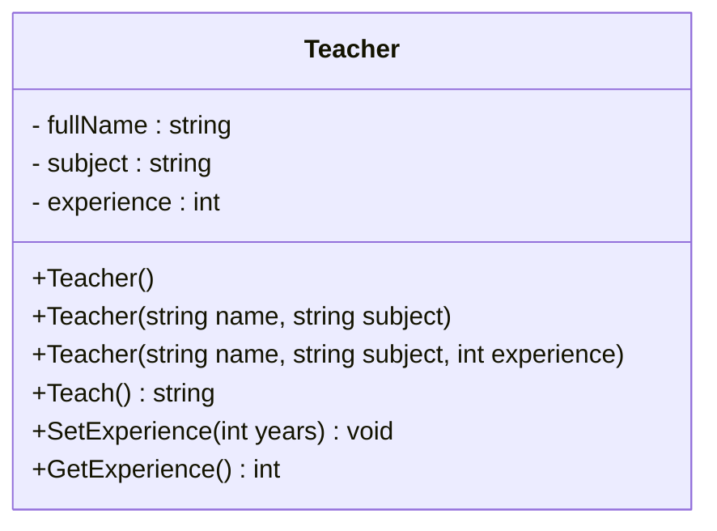
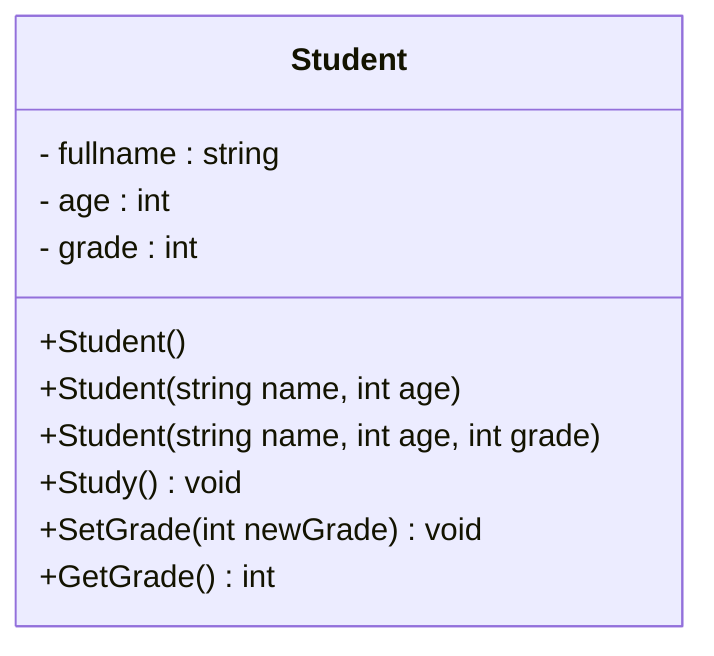
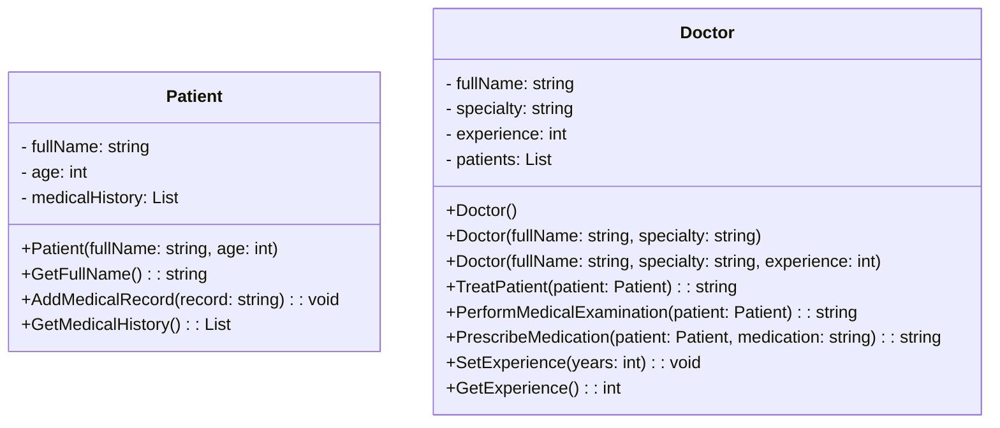
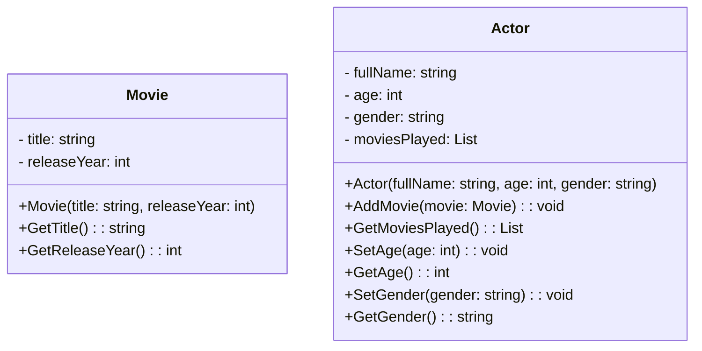

## 🧩 **Задание 1 – Класс `Teacher` (Учитель)**

Создайте класс `Teacher` со следующими полями (инкапсулированными `private`):

* `fullName` — строка, имя учителя.
* `subject` — строка, предмет, который он преподаёт.
* `experience` — целое число, количество лет опыта.

Методы:

1. `Teach()` — выводит сообщение в формате: `{fullName} is teaching {subject}.`
2. `SetExperience(int years)` — устанавливает значение стажа.
3. `GetExperience()` — возвращает стаж.

Конструкторы:

1. Пустой конструктор (ничего не делает).
2. Конструктор с параметрами: имя и предмет.
3. Конструктор с параметрами: имя, предмет, стаж.

---

## 🧩 **Задание 2 – Класс `Student` (Студент)**

Создайте класс `Student` со следующими полями (`private`) и доступом через **свойства**:

* `fullname` — строка, имя студента.
* `age` — целое число, возраст студента.
* `grade` — целое число, текущий уровень (например, класс).

Методы:

1. `Study()` — выводит сообщение: `{fullname} is studying.`
2. `SetGrade(int newGrade)` — устанавливает оценку.
3. `GetGrade()` — возвращает оценку.

Конструкторы:

1. Пустой.
2. С параметрами: имя и возраст.
3. С параметрами: имя, возраст и класс.

---

## 🧩 **Задание 3 – Класс `Doctor` с классом `Patient`**

Создайте два класса: `Doctor` и `Patient`.  

Класс `Patient` содержит следующие `private` поля:  
- `fullName` — строка, полное имя пациента.  
- `age` — целое число, возраст.  
- `medicalHistory` — список строк, история медицинских посещений или диагнозов.

Класс `Doctor` со следующими `private` полями:  
- `fullName` — строка, полное имя.  
- `specialty` — строка, специальность.  
- `experience` — целое число, стаж.  
- `patients` — список объектов типа `Patient`.

Методы класса `Doctor`:  
1. `TreatPatient(Patient patient)` → возвращает строку:  
   `"{fullName}, {specialty}, лечит пациента {patient.FullName}"`
2. `PerformMedicalExamination(Patient patient)` → возвращает строку:  
   `"{fullName} проводит медицинское обследование для пациента {patient.FullName}"`
3. `PrescribeMedication(Patient patient, string medication)` → возвращает строку:  
   `"{fullName} назначает {medication} пациенту {patient.FullName}"`
4. `SetExperience(int years)` — установить стаж.  
5. `GetExperience()` — получить стаж.

Конструкторы:  
1. Без параметров.  
2. С двумя параметрами: имя и специальность.  
3. С тремя параметрами: имя, специальность, стаж.

Класс `Patient` должен содержать:  
- Конструктор, принимающий имя, возраст и при необходимости, историю (можно оставить пустой).  
- Методы:  
  - `GetFullName()` — вернуть полное имя.  
  - `AddMedicalRecord(string record)` — добавить запись в историю.  
  - `GetMedicalHistory()` — вернуть историю.

---

## 🧩 **Задание 4 – Класс `Actor` (Актёр) с классом `Movie`**

Создайте два класса: `Actor` и `Movie`.  

Класс `Movie` должен содержать следующие `private` поля:  
- `title` — строка, название фильма.  
- `releaseYear` — целое число, год выпуска.

Класс `Actor` со следующими `private` полями:  
- `fullName` — строка, имя актёра.  
- `age` — целое число, возраст.  
- `gender` — строка, пол.  
- `moviesPlayed` — список объектов типа `Movie`, фильмы, в которых участвовал.

Методы класса `Actor`:  
1. `AddMovie(Movie movie)` — добавить фильм в список.  
2. `GetMoviesPlayed()` — вернуть список фильмов.  
3. `SetAge(int age)` — установить возраст.  
4. `GetAge()` — вернуть возраст.  
5. `SetGender(string gender)` — установить пол.  
6. `GetGender()` — вернуть пол.  

Конструктор класса `Actor`:  
- Принимает имя, возраст и пол.

Конструктор класса `Movie`:  
- Принимает название и год выпуска.

---