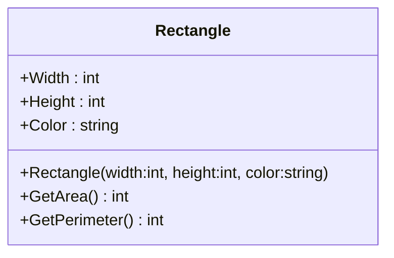
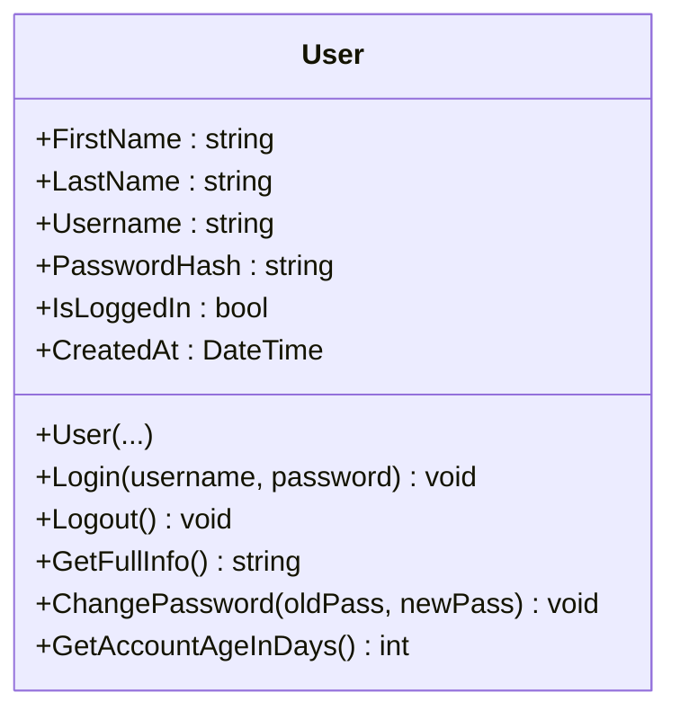
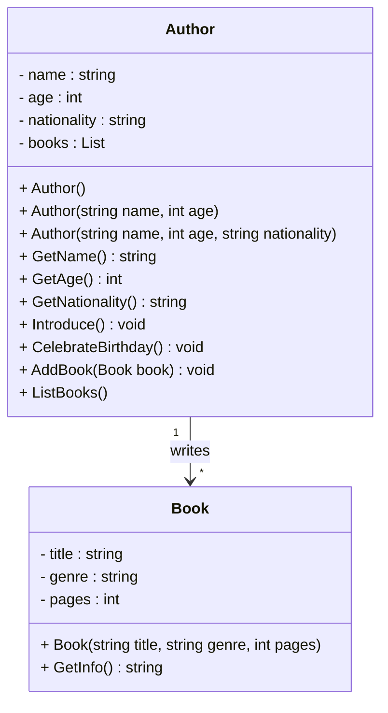
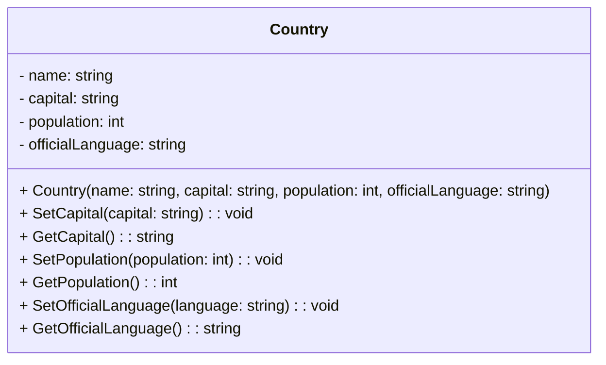

Вот задания с **только русской версией**, без английского и таджикского текста:

---

### 🧩 **Задание 1 – Класс `Rectangle`**

Создайте класс под названием `Rectangle` со следующими характеристиками:

* `Width`: целое число, представляющее ширину прямоугольника.
* `Height`: целое число, представляющее высоту прямоугольника.
* `Color`: строка, представляющая цвет прямоугольника.
* `GetArea()`: возвращает площадь прямоугольника.
* `GetPerimeter()`: возвращает периметр прямоугольника.
* Конструктор: Принимает значения ширины, высоты и цвета, и инициализирует объект.



---

### 🧩 **Задание 2 – Класс `User`**

**Свойства:**

* `FirstName` (string) — имя пользователя.
* `LastName` (string) — фамилия пользователя.
* `PasswordHash` (string) — хешированный пароль (имитация).
* `IsLoggedIn` (bool) — флаг, указывающий, вошёл ли пользователь в систему.
* `CreatedAt` (DateTime) — дата регистрации пользователя.

**Методы:**

* `void Login(string username, string password)` — если имя пользователя и пароль совпадают (учитывая хеш), установить `*IsLoggedIn = true*` и вывести: "Добро пожаловать, FirstName!". Иначе — "Ошибка входа: проверьте логин или пароль."

* `void Logout()` — устанавливает IsLoggedIn = false и выводит: "Вы вышли из системы."

* `string GetFullInfo()` — возвращает строку вида: "Иван Иванов | Логин: ivan123 | Онлайн: true"

* `void ChangePassword(string oldPassword, string newPassword)` — изменяет пароль, если старый пароль совпадает.

* `int GetAccountAgeInDays()` — возвращает количество дней с момента регистрации.
* Конструктор должен принимать `FirstName`, `LastName`, `Username` и `Password`, хешировать пароль и установить дату создания.




---

Вот улучшенная и более интересная версия задания с добавлением класса `Book`, который связан с `Author`. Это приближает задачу к реальной жизни и помогает лучше понять взаимодействие классов через композицию:

---

### 🧩 **Задание 3 – Классы `Author` и `Book`**

Создайте два класса: `Author` и `Book`, где каждый автор может иметь одну или несколько книг.

---

#### **Класс `Author`**

**Поля:**

* `name` (строка) — имя автора.
* `age` (int) — возраст автора.
* `nationality` (строка) — национальность.
* `books` (список книг) — список книг автора (класс `Book`).

**Методы:**

* `GetName()` — возвращает имя.
* `GetAge()` — возвращает возраст.
* `GetNationality()` — возвращает национальность.
* `Introduce()` — выводит: `"Меня зовут {name}. Мне {age} лет. Я из {nationality}."`
* `CelebrateBirthday()` — увеличивает возраст на 1.
* `AddBook(Book book)` — добавляет книгу в список книг.
* `ListBooks()` — Возврашает всех книг автора.

**Конструкторы:**

* Без параметров — задаёт значения по умолчанию.
* С параметрами `name`, `age`.
* С параметрами `name`, `age`, `nationality`.

---

#### **Класс `Book`**

**Поля:**

* `title` (строка) — название книги.
* `genre` (строка) — жанр.
* `pages` (int) — количество страниц.

**Методы:**

* `GetInfo()` — возвращает строку: `"Книга: {title}, Жанр: {genre}, Страниц: {pages}"`.

**Конструкторы:**

* С параметрами `title`, `genre`, `pages`.

---


---


### 🧩 **Задание 4 – Класс `Country`**

Создайте класс `Country` со следующими характеристиками:

* `name` — название страны (строка).
* `capital` — столица страны (строка).
* `population` — население (int).
* `officialLanguage` — официальный язык (строка).

**Методы:**

* `SetCapital(string capital)` — установить столицу.
* `GetCapital()` — вернуть столицу.
* `SetPopulation(int population)` — установить население.
* `GetPopulation()` — вернуть население.
* `SetOfficialLanguage(string language)` — установить язык.
* `GetOfficialLanguage()` — вернуть язык.

**Конструктор:**

* Принимает параметры: название, столицу, население и язык.



**Пример вывода:**

```
Country Name: Узбекистан  
Capital: Ташкент  
Population: 38 000 000  
Official Language: узбекский  
```

---

